# tempoPlot: Microbiome Time Series Visualization

## Introduction

`tempoPlot` plots longitudinal microbiome data stored in
`TreeSummarizedExperiment` and `MultiAssayExperiment` objects. The
computation belongs to
*[miaTime](https://bioconductor.org/packages/3.24/miaTime)* and
*[mia](https://bioconductor.org/packages/3.24/mia)*: they add
divergences, variograms, dissimilarities, states and ordinations to the
object, and `tempoPlot` draws them. Every function returns a `ggplot`
object, except
[`plotTimeline()`](https://0xmuluh.github.io/tempoPlot/reference/plotTimeline.md),
which stacks several into a patchwork.

This vignette follows one analysis from the sampling design to
ordinations and networks. Each step asks a question, computes what it
needs with mia or miaTime, and plots the result.

| Question | Function |
|----|----|
| When were samples taken? | [`plotSwimmer()`](https://0xmuluh.github.io/tempoPlot/reference/plotSwimmer.md) |
|  | [`plotGaps()`](https://0xmuluh.github.io/tempoPlot/reference/plotGaps.md) |
|  | [`plotCalendar()`](https://0xmuluh.github.io/tempoPlot/reference/plotCalendar.md) |
| What happened to one subject? | [`plotTimeline()`](https://0xmuluh.github.io/tempoPlot/reference/plotTimeline.md) |
| How does a value change over time? | [`plotTrend()`](https://0xmuluh.github.io/tempoPlot/reference/plotTrend.md) |
|  | [`plotTimeEffect()`](https://0xmuluh.github.io/tempoPlot/reference/plotTimeEffect.md) |
|  | [`plotIntervals()`](https://0xmuluh.github.io/tempoPlot/reference/plotIntervals.md) |
|  | [`plotRmcorr()`](https://0xmuluh.github.io/tempoPlot/reference/plotRmcorr.md) |
| How does the composition change? | [`plotComposition()`](https://0xmuluh.github.io/tempoPlot/reference/plotComposition.md) |
|  | [`plotTiles()`](https://0xmuluh.github.io/tempoPlot/reference/plotTiles.md) |
|  | [`plotProfiles()`](https://0xmuluh.github.io/tempoPlot/reference/plotProfiles.md) |
|  | [`plotHorizon()`](https://0xmuluh.github.io/tempoPlot/reference/plotHorizon.md) |
|  | [`plotRanks()`](https://0xmuluh.github.io/tempoPlot/reference/plotRanks.md) |
| How fast and how much do communities change? | [`plotTurnover()`](https://0xmuluh.github.io/tempoPlot/reference/plotTurnover.md) |
|  | [`plotChanges()`](https://0xmuluh.github.io/tempoPlot/reference/plotChanges.md) |
|  | [`plotTBI()`](https://0xmuluh.github.io/tempoPlot/reference/plotTBI.md) |
|  | [`plotLagProfile()`](https://0xmuluh.github.io/tempoPlot/reference/plotLagProfile.md) |
|  | [`plotRecurrence()`](https://0xmuluh.github.io/tempoPlot/reference/plotRecurrence.md) |
|  | [`plotIndividuality()`](https://0xmuluh.github.io/tempoPlot/reference/plotIndividuality.md) |
|  | [`plotFingerprint()`](https://0xmuluh.github.io/tempoPlot/reference/plotFingerprint.md) |
|  | [`plotDOC()`](https://0xmuluh.github.io/tempoPlot/reference/plotDOC.md) |
| Are there states and rhythms? | [`plotTransitionMatrix()`](https://0xmuluh.github.io/tempoPlot/reference/plotTransitionMatrix.md) |
|  | [`plotAlluvial()`](https://0xmuluh.github.io/tempoPlot/reference/plotAlluvial.md) |
|  | [`plotStates()`](https://0xmuluh.github.io/tempoPlot/reference/plotStates.md) |
|  | [`plotRuns()`](https://0xmuluh.github.io/tempoPlot/reference/plotRuns.md) |
|  | [`plotSurvival()`](https://0xmuluh.github.io/tempoPlot/reference/plotSurvival.md) |
|  | [`plotLandscape()`](https://0xmuluh.github.io/tempoPlot/reference/plotLandscape.md) |
|  | [`plotSpectrum()`](https://0xmuluh.github.io/tempoPlot/reference/plotSpectrum.md) |
|  | [`plotNoise()`](https://0xmuluh.github.io/tempoPlot/reference/plotNoise.md) |
|  | [`plotLagHeatmap()`](https://0xmuluh.github.io/tempoPlot/reference/plotLagHeatmap.md) |
| What does a subject share with its partner? | [`plotPartner()`](https://0xmuluh.github.io/tempoPlot/reference/plotPartner.md) |
|  | [`plotOrigin()`](https://0xmuluh.github.io/tempoPlot/reference/plotOrigin.md) |
| Which features or subjects stand out? | [`plotStats()`](https://0xmuluh.github.io/tempoPlot/reference/plotStats.md) |
|  | [`plotVolcano()`](https://0xmuluh.github.io/tempoPlot/reference/plotVolcano.md) |
|  | [`plotFeatureScatter()`](https://0xmuluh.github.io/tempoPlot/reference/plotFeatureScatter.md) |
|  | [`plotSubjectScatter()`](https://0xmuluh.github.io/tempoPlot/reference/plotSubjectScatter.md) |
|  | [`plotTimeLoadings()`](https://0xmuluh.github.io/tempoPlot/reference/plotTimeLoadings.md) |
| How do subjects move in ordinations and networks? | [`plotPath()`](https://0xmuluh.github.io/tempoPlot/reference/plotPath.md) |
|  | [`plotDirection()`](https://0xmuluh.github.io/tempoPlot/reference/plotDirection.md) |
|  | [`plotProcrustes()`](https://0xmuluh.github.io/tempoPlot/reference/plotProcrustes.md) |
|  | [`plotNetwork()`](https://0xmuluh.github.io/tempoPlot/reference/plotNetwork.md) |

## Installation

\
`if`` ``(``!`[`requireNamespace`](https://rdrr.io/r/base/ns-load.html)`(``"remotes"``, quietly ``=`` ``TRUE``)``)`\
`    `[`install.packages`](https://rdrr.io/r/utils/install.packages.html)`(``"remotes"``)`\
`remotes``::`[`install_github`](https://remotes.r-lib.org/reference/install_github.html)`(``"0xMuluh/tempoPlot"``)`

## Data

The workflow uses two datasets from miaTime. `hitchip1006` holds
genus-level profiles of 1006 western adults (Lahti et al. 2014), some of
whom were sampled up to five times. `minimalgut` holds a defined
community of 16 species in three bioreactors, sampled three times a day
for 20 days under the same perturbations (Shetty et al. 2022). The
cohort has sparse, irregular sampling of many people; the bioreactors
have dense sampling of a few units.

\
[`library`](https://rdrr.io/r/base/library.html)`(`[`tempoPlot`](https://github.com/0xMuluh/tempoPlot)`)`\
[`library`](https://rdrr.io/r/base/library.html)`(`[`mia`](https://microbiome.github.io/mia/)`)`\
[`library`](https://rdrr.io/r/base/library.html)`(`[`miaTime`](https://github.com/microbiome/miaTime)`)`\
\
[`data`](https://rdrr.io/r/utils/data.html)`(``"hitchip1006"``, ``"minimalgut"``, package ``=`` ``"miaTime"``)`

The cohort analysis keeps the 77 subjects sampled at least twice and
numbers each subject’s samples as visits.

\
`# Eleven profiles are stored twice; keep the first copy`\
`tse`` ``<-`` ``hitchip1006``[``, ``!`[`duplicated`](https://rdrr.io/r/base/duplicated.html)`(`[`t`](https://rdrr.io/r/base/t.html)`(`[`assay`](https://rdrr.io/pkg/SummarizedExperiment/man/SummarizedExperiment-class.html)`(``hitchip1006``, ``"counts"``)``)``)``]`\
`tse`` ``<-`` ``tse``[``, ``tse``$``subject`` `[`%in%`](https://rdrr.io/r/base/match.html)` `[`names`](https://rdrr.io/r/base/names.html)`(`[`which`](https://rdrr.io/r/base/which.html)`(`[`table`](https://rdrr.io/r/base/table.html)`(``tse``$``subject``)`` ``>=`` ``2``)``)``]`\
`tse``$``visit`` ``<-`` `[`factor`](https://rdrr.io/r/base/factor.html)`(`[`ave`](https://rdrr.io/r/stats/ave.html)`(``tse``$``time``, ``tse``$``subject``, FUN ``=`` ``rank``)``)`

The bioreactor analysis uses relative abundances.

\
`mg`` ``<-`` `[`transformAssay`](https://microbiome.github.io/mia/reference/transformAssay.html)`(``minimalgut``, method ``=`` ``"relabundance"``)`

## Study design

**When was each subject sampled?**
[`plotSwimmer()`](https://0xmuluh.github.io/tempoPlot/reference/plotSwimmer.md)
draws one lane per subject with a point for each sample.

\
[`plotSwimmer`](https://0xmuluh.github.io/tempoPlot/reference/plotSwimmer.md)`(``tse``, time.col ``=`` ``"time"``, group ``=`` ``"subject"``,`\
`    colour.by ``=`` ``"bmi_group"``)`

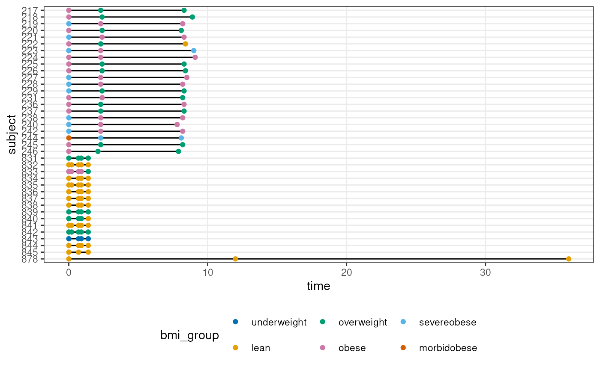

The cohort mixes designs. A group of mostly lean subjects was sampled
four or five times over a short span. Most overweight and obese subjects
were sampled two or three times over a longer span, and three subjects
were followed up only after 12 or more time units.

The bioreactors share one schedule of perturbations. `events` draws them
as bands (with an `end`) or lines (without one).

\
`events`` ``<-`` `[`data.frame`](https://rdrr.io/r/base/data.frame.html)`(`\
`    start ``=`` `[`c`](https://rdrr.io/r/base/c.html)`(``0``, ``152``, ``432``)``,`\
`    end ``=`` `[`c`](https://rdrr.io/r/base/c.html)`(``24``, ``NA``, ``436``)``,`\
`    label ``=`` `[`c`](https://rdrr.io/r/base/c.html)`(``"batch"``, ``"Blautia added"``, ``"double dilution rate"``)``)`\
[`plotSwimmer`](https://0xmuluh.github.io/tempoPlot/reference/plotSwimmer.md)`(``mg``, time.col ``=`` ``"Time.hr"``, group ``=`` ``"StudyIdentifier"``,`\
`    events ``=`` ``events``)`

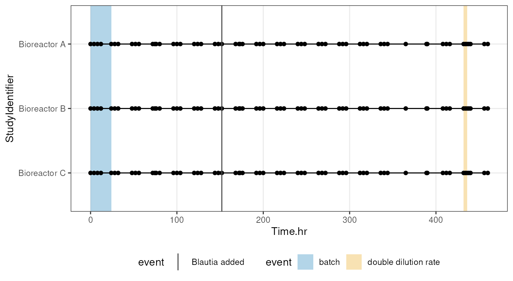

**How long are the intervals between samples?**
[`plotGaps()`](https://0xmuluh.github.io/tempoPlot/reference/plotGaps.md)
draws the time between consecutive samples of each subject.

\
[`plotGaps`](https://0xmuluh.github.io/tempoPlot/reference/plotGaps.md)`(``tse``, time.col ``=`` ``"time"``, group ``=`` ``"subject"``, group.by ``=`` ``"sex"``,`\
`    layout ``=`` ``"box"``)`

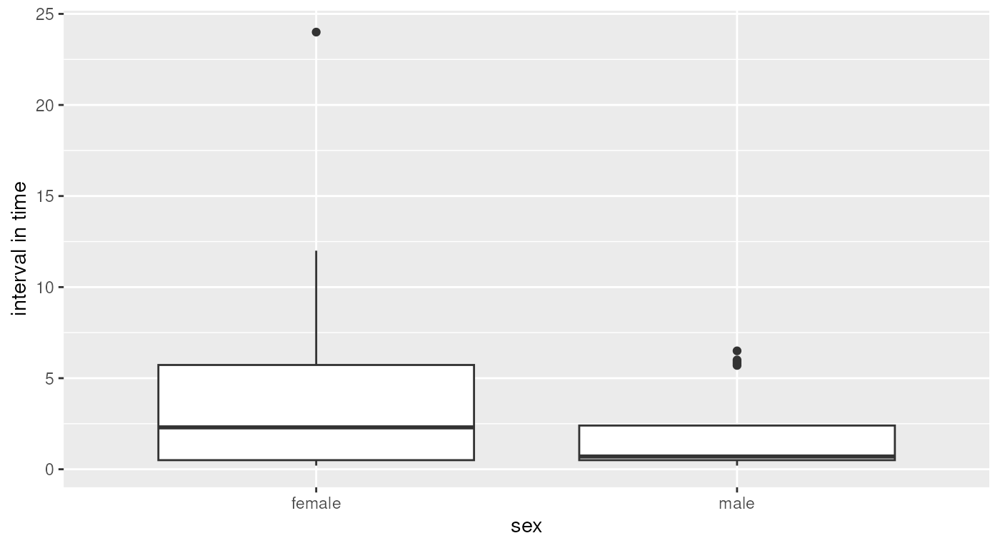

Most intervals are shorter than seven time units; the outliers are the
late follow-ups seen above. Keep these intervals in mind when choosing
time lags or a `max.gap`.

**On which days were samples taken?**
[`plotCalendar()`](https://0xmuluh.github.io/tempoPlot/reference/plotCalendar.md)
counts samples per day for `Date` or `POSIXct` times. The bioreactor
data hold hours since the start of the run, not dates, so the run is
placed on an arbitrary start date.

\
`mg``$``date`` ``<-`` `[`as.POSIXct`](https://rdrr.io/r/base/as.POSIXlt.html)`(``"2020-01-06"``, tz ``=`` ``"UTC"``)`` ``+`` ``mg``$``Time.hr`` ``*`` ``3600`\
[`plotCalendar`](https://0xmuluh.github.io/tempoPlot/reference/plotCalendar.md)`(``mg``, time.col ``=`` ``"date"``)`

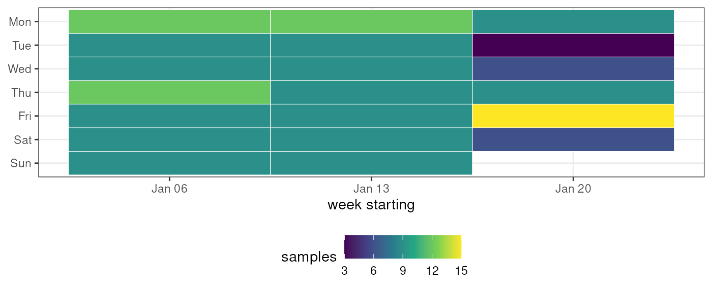

Most days have nine samples, three per bioreactor. The busiest day, 18
days into the run, is the double-dilution perturbation, and one day late
in the run has only three samples. The weekdays here are arbitrary; with
real dates the same plot shows weekend and holiday gaps.

## Values over time

**How far does each subject move from their first sample?**
[`addBaselineDivergence()`](https://rdrr.io/pkg/miaTime/man/getBaselineDivergence.html)
from miaTime computes the dissimilarity of each sample from the
subject’s first one.
[`plotTrend()`](https://0xmuluh.github.io/tempoPlot/reference/plotTrend.md)
draws it by visit.

\
`tse`` ``<-`` `[`addBaselineDivergence`](https://rdrr.io/pkg/miaTime/man/getBaselineDivergence.html)`(``tse``, group ``=`` ``"subject"``, time.col ``=`` ``"time"``,`\
`    assay.type ``=`` ``"counts"``)`\
[`plotTrend`](https://0xmuluh.github.io/tempoPlot/reference/plotTrend.md)`(``tse``, y ``=`` ``"divergence"``, time.col ``=`` ``"visit"``, group ``=`` ``"subject"``,`\
`    group.by ``=`` ``"sex"``, layout ``=`` ``"box"``)`

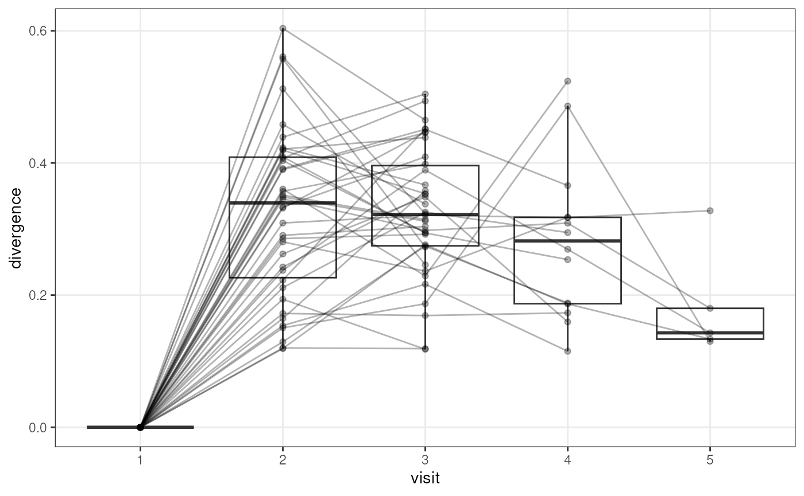

Most of the distance from the first sample is reached by the second
visit; later visits are no further away. Visits are ranks, and visits 4
and 5 come only from the densely sampled group, so the same visit lies
at different times in different subjects.

[`plotTrend()`](https://0xmuluh.github.io/tempoPlot/reference/plotTrend.md)
reads a colData column, a feature or an ordination component. Here
acetate in each bioreactor, with the perturbations marked.

\
[`plotTrend`](https://0xmuluh.github.io/tempoPlot/reference/plotTrend.md)`(``mg``, y ``=`` ``"Acetate"``, time.col ``=`` ``"Time.hr"``,`\
`    group ``=`` ``"StudyIdentifier"``, group.by ``=`` ``"StudyIdentifier"``,`\
`    events ``=`` ``events``)`

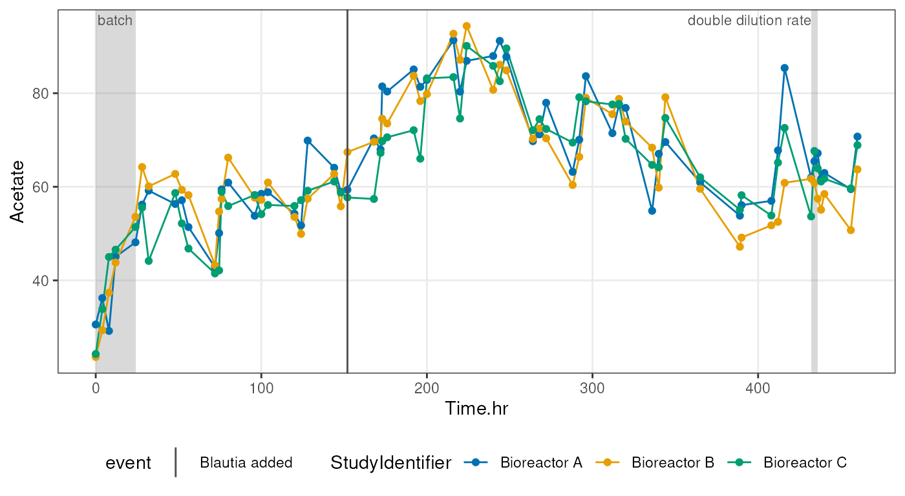

The three bioreactors track each other. Acetate rises after Blautia
hydrogenotrophica is added at 152 h, peaks between about 200 and 250 h,
and falls back towards its earlier level.

**Does the difference in diversity between men and women change over
time?** Fit the model you need, one row per time, and pass the estimates
to
[`plotTimeEffect()`](https://0xmuluh.github.io/tempoPlot/reference/plotTimeEffect.md).
Each subject has one sample per visit, so a linear model per visit
compares independent subjects.

\
`cd`` ``<-`` `[`as.data.frame`](https://rdrr.io/r/base/as.data.frame.html)`(`[`colData`](https://rdrr.io/pkg/SummarizedExperiment/man/SummarizedExperiment-class.html)`(``tse``)``)`\
`effect`` ``<-`` `[`do.call`](https://rdrr.io/r/base/do.call.html)`(``rbind``, `[`lapply`](https://rdrr.io/r/base/lapply.html)`(`[`split`](https://rdrr.io/r/base/split.html)`(``cd``, ``cd``$``visit``)``, ``function``(``d``)`` ``{`\
`    ``model`` ``<-`` `[`lm`](https://rdrr.io/r/stats/lm.html)`(``diversity`` ``~`` ``sex``, data ``=`` ``d``)`\
`    ``ci`` ``<-`` `[`confint`](https://rdrr.io/r/stats/confint.html)`(``model``)``[``"sexmale"``, ``]`\
`    `[`data.frame`](https://rdrr.io/r/base/data.frame.html)`(``visit ``=`` ``d``$``visit``[``1``]``, estimate ``=`` `[`coef`](https://rdrr.io/r/stats/coef.html)`(``model``)``[[``"sexmale"``]``]``,`\
`        lower ``=`` ``ci``[[``1``]``]``, upper ``=`` ``ci``[[``2``]``]``)`\
`}``)``)`\
[`plotTimeEffect`](https://0xmuluh.github.io/tempoPlot/reference/plotTimeEffect.md)`(``effect``, time.col ``=`` ``"visit"``)`

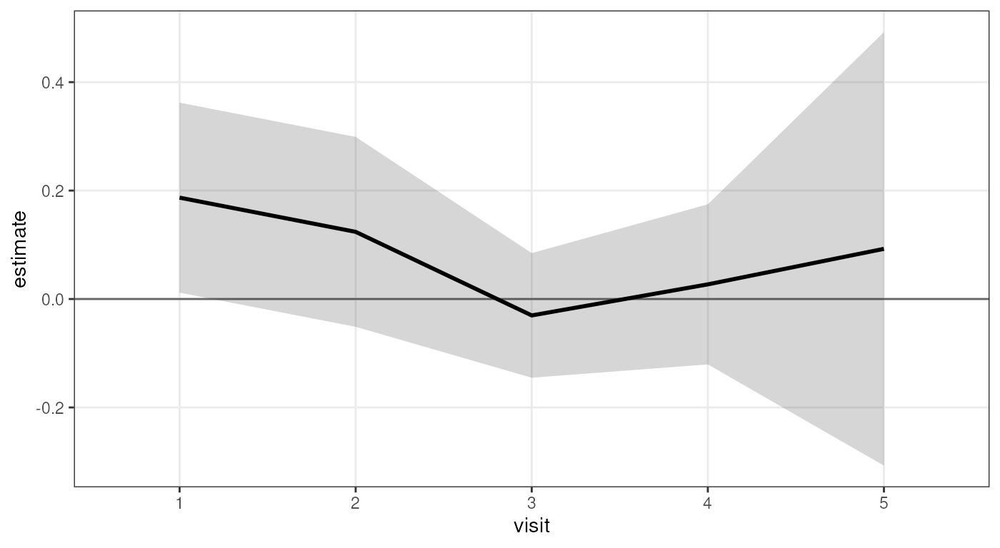

Men had higher diversity than women at the first visit, with an interval
that just excludes zero. At later visits the intervals include zero and
widen as fewer subjects remain.

## Composition over time

**Which species dominate, and when?**
[`plotComposition()`](https://0xmuluh.github.io/tempoPlot/reference/plotComposition.md)
stacks the most abundant features over time.

\
[`plotComposition`](https://0xmuluh.github.io/tempoPlot/reference/plotComposition.md)`(``mg``, time.col ``=`` ``"Time.hr"``, group ``=`` ``"StudyIdentifier"``,`\
`    top ``=`` ``8``, layout ``=`` ``"area"``)`

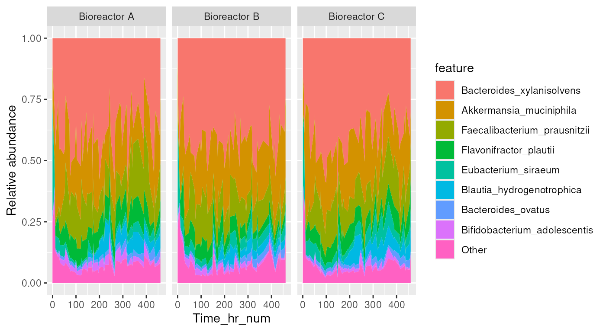

Bacteroides xylanisolvens makes up about half of each community. Blautia
hydrogenotrophica appears after it is added at 152 h, and the three
bioreactors follow similar courses.

In the cohort, `level = "group"` averages the phyla of the subjects in
each group at each visit.

\
`phyla`` ``<-`` `[`agglomerateByRank`](https://microbiome.github.io/mia/reference/agglomerate-methods.html)`(``tse``, rank ``=`` ``"Phylum"``)`\
[`plotComposition`](https://0xmuluh.github.io/tempoPlot/reference/plotComposition.md)`(``phyla``, time.col ``=`` ``"visit"``, group ``=`` ``"subject"``,`\
`    level ``=`` ``"group"``, group.by ``=`` ``"sex"``)`

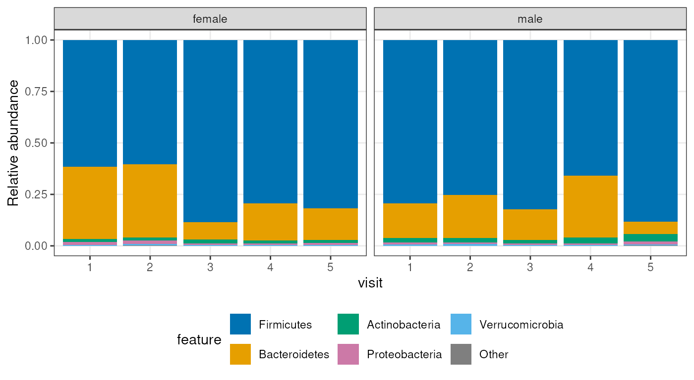

Firmicutes and Bacteroidetes make up nearly all of each profile. The
Bacteroidetes share varies between visits; later visits average fewer
subjects, so their means are less precise.

**Which species rise and fall together?**
[`plotTiles()`](https://0xmuluh.github.io/tempoPlot/reference/plotTiles.md)
draws features by time as a heatmap. `value = "change"` shows the change
from the first sample, and `order.by = "cluster"` puts features with
similar courses next to each other.

\
[`plotTiles`](https://0xmuluh.github.io/tempoPlot/reference/plotTiles.md)`(``mg``, time.col ``=`` ``"Time.hr"``, group ``=`` ``"StudyIdentifier"``,`\
`    assay.type ``=`` ``"relabundance"``, value ``=`` ``"change"``, order.by ``=`` ``"cluster"``,`\
`    level ``=`` ``"group"``)`

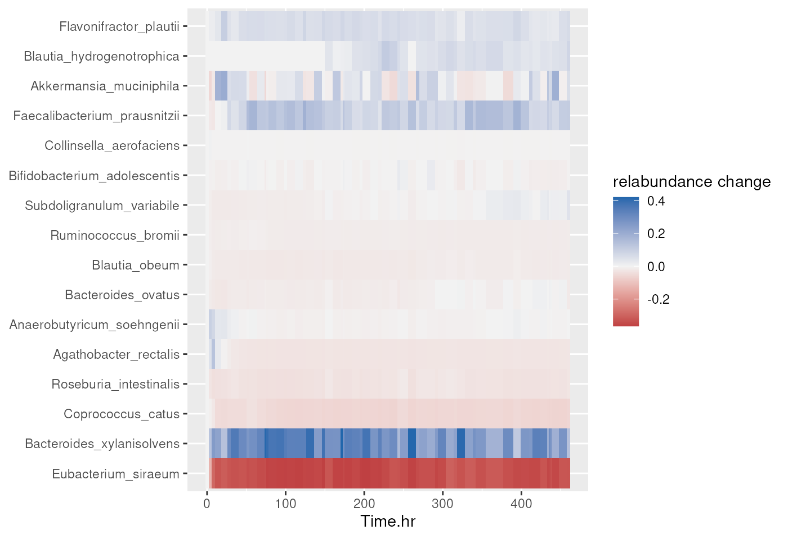

Bacteroides xylanisolvens gains and Eubacterium siraeum loses most from
the start of the run, and Blautia hydrogenotrophica appears after 152 h.
The other species change less.

**When does each species leave its earlier range?**
[`plotIntervals()`](https://0xmuluh.github.io/tempoPlot/reference/plotIntervals.md)
draws time intervals of features from a table with columns `feature`,
`start` and `end`, such as the significant intervals of MetaLonDA. Here
an interval is a run of times after 152 h in which the mean relative
abundance over the three bioreactors lies above or below its range
before 152 h.

\
`ra`` ``<-`` `[`assay`](https://rdrr.io/pkg/SummarizedExperiment/man/SummarizedExperiment-class.html)`(``mg``, ``"relabundance"``)`\
`time`` ``<-`` ``mg``$``Time.hr`\
`mean_ra`` ``<-`` `[`t`](https://rdrr.io/r/base/t.html)`(`[`rowsum`](https://rdrr.io/r/base/rowsum.html)`(`[`t`](https://rdrr.io/r/base/t.html)`(``ra``)``, ``time``)`` ``/`` `[`as.vector`](https://rdrr.io/r/base/vector.html)`(`[`table`](https://rdrr.io/r/base/table.html)`(``time``)``)``)`\
`times`` ``<-`` `[`as.numeric`](https://rdrr.io/r/base/numeric.html)`(`[`colnames`](https://rdrr.io/r/base/colnames.html)`(``mean_ra``)``)`\
`before`` ``<-`` ``times`` ``<`` ``152`\
`low`` ``<-`` `[`apply`](https://rdrr.io/r/base/apply.html)`(``mean_ra``[``, ``before``]``, ``1``, ``min``)`\
`high`` ``<-`` `[`apply`](https://rdrr.io/r/base/apply.html)`(``mean_ra``[``, ``before``]``, ``1``, ``max``)`\
`after`` ``<-`` ``times``[``!``before``]`\
`intervals`` ``<-`` `[`do.call`](https://rdrr.io/r/base/do.call.html)`(``rbind``, `[`lapply`](https://rdrr.io/r/base/lapply.html)`(`[`rownames`](https://rdrr.io/r/base/colnames.html)`(``mean_ra``)``, ``function``(``f``)`` ``{`\
`    ``v`` ``<-`` ``mean_ra``[``f``, ``!``before``]`\
`    ``side`` ``<-`` `[`ifelse`](https://rdrr.io/r/base/ifelse.html)`(``v`` ``>`` ``high``[``f``]``, ``"above"``, `[`ifelse`](https://rdrr.io/r/base/ifelse.html)`(``v`` ``<`` ``low``[``f``]``, ``"below"``, ``NA``)``)`\
`    ``runs`` ``<-`` `[`rle`](https://rdrr.io/r/base/rle.html)`(``side``)`\
`    ``end`` ``<-`` `[`cumsum`](https://rdrr.io/r/base/cumsum.html)`(``runs``$``lengths``)`\
`    ``start`` ``<-`` ``end`` ``-`` ``runs``$``lengths`` ``+`` ``1`\
`    ``keep`` ``<-`` ``!`[`is.na`](https://rdrr.io/r/base/NA.html)`(``runs``$``values``)`\
`    `[`data.frame`](https://rdrr.io/r/base/data.frame.html)`(``feature ``=`` `[`rep`](https://rdrr.io/r/base/rep.html)`(``f``, `[`sum`](https://rdrr.io/r/base/sum.html)`(``keep``)``)``, start ``=`` ``after``[``start``[``keep``]``]``,`\
`        end ``=`` ``after``[``end``[``keep``]``]``, direction ``=`` ``runs``$``values``[``keep``]``)`\
`}``)``)`\
[`plotIntervals`](https://0xmuluh.github.io/tempoPlot/reference/plotIntervals.md)`(``intervals``, colour.by ``=`` ``"direction"``, top ``=`` ``10``)`

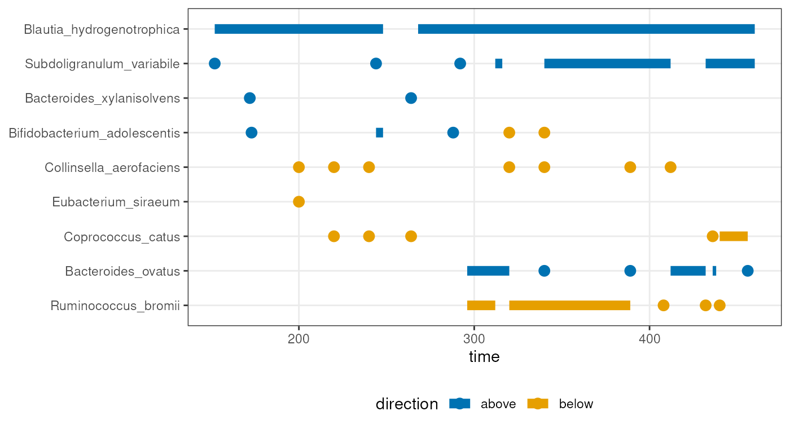

Blautia hydrogenotrophica stays above its earlier range for most of the
time after it is added. Subdoligranulum variabile rises above its range
from about 340 h, and Ruminococcus bromii falls below its range between
about 300 and 390 h. Points mark single times.

[`plotHorizon()`](https://0xmuluh.github.io/tempoPlot/reference/plotHorizon.md)
folds each feature into a short strip, so that many features fit in one
figure. Each strip is centred on the feature’s median; darker bands are
further from it.

\
[`plotHorizon`](https://0xmuluh.github.io/tempoPlot/reference/plotHorizon.md)`(``mg``, time.col ``=`` ``"Time.hr"``, group ``=`` ``"StudyIdentifier"``,`\
`    assay.type ``=`` ``"relabundance"``, top ``=`` ``8``)`

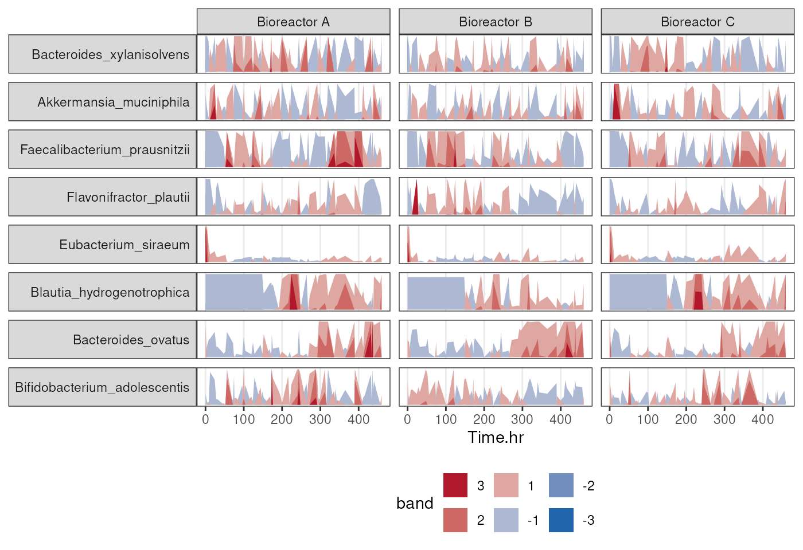

Blautia hydrogenotrophica stays below its median until it is added and
above it afterwards. Bacteroides ovatus rises above its median after
about 300 h in all three bioreactors.

**Does the order of the species change?**
[`plotRanks()`](https://0xmuluh.github.io/tempoPlot/reference/plotRanks.md)
follows the rank of each feature.

\
[`plotRanks`](https://0xmuluh.github.io/tempoPlot/reference/plotRanks.md)`(``mg``, time.col ``=`` ``"Time.hr"``, group ``=`` ``"StudyIdentifier"``, top ``=`` ``8``)`

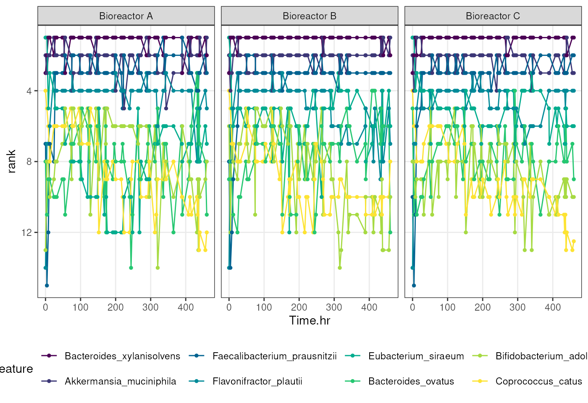

Bacteroides xylanisolvens and Akkermansia muciniphila hold the top two
ranks for most of the run; the species below them change places often.

## Community change

**How many species appear and disappear between samples?**
[`plotTurnover()`](https://0xmuluh.github.io/tempoPlot/reference/plotTurnover.md)
counts the features gained and lost between consecutive samples.

\
[`plotTurnover`](https://0xmuluh.github.io/tempoPlot/reference/plotTurnover.md)`(``mg``, time.col ``=`` ``"Time.hr"``, group ``=`` ``"StudyIdentifier"``)`

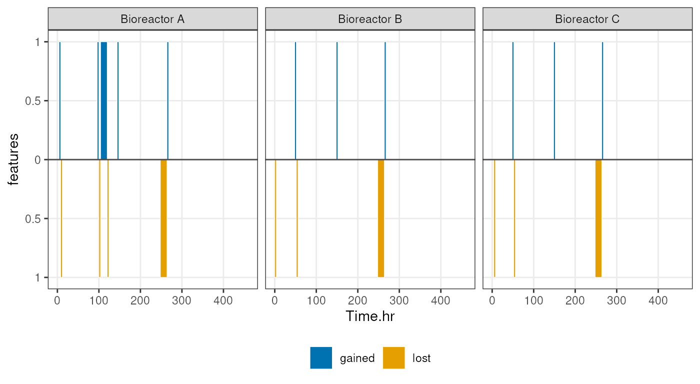

In this defined community almost every species is detected in every
sample. At most one species is lost or gained between two samples.

**Which subjects lost or gained most genera?**
[`plotTBI()`](https://0xmuluh.github.io/tempoPlot/reference/plotTBI.md)
splits the change between two time points into losses and gains
(Legendre 2019), here of genera present or absent at the first and
second visit.

\
[`plotTBI`](https://0xmuluh.github.io/tempoPlot/reference/plotTBI.md)`(``tse``, time.col ``=`` ``"visit"``, group ``=`` ``"subject"``,`\
`    time.point ``=`` `[`c`](https://rdrr.io/r/base/c.html)`(``"1"``, ``"2"``)``, colour.by ``=`` ``"sex"``)`

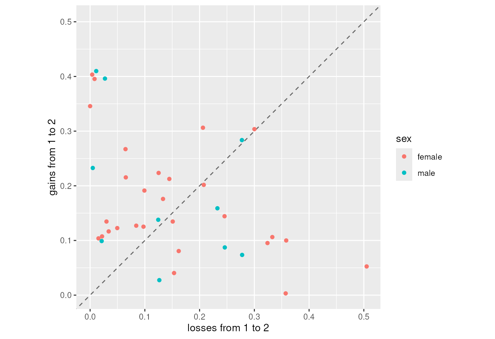

Points above the diagonal gained more genera than they lost; points
below lost more. All changes are small: the genera present change little
between the first two visits.

**How does dissimilarity grow with the time between samples?**
[`addVariogram()`](https://rdrr.io/pkg/miaTime/man/getVariogram.html)
from miaTime computes the mean dissimilarity between samples of a
subject at each time lag, with an interval.
[`plotLagProfile()`](https://0xmuluh.github.io/tempoPlot/reference/plotLagProfile.md)
draws it.

\
`tse`` ``<-`` `[`transformAssay`](https://microbiome.github.io/mia/reference/transformAssay.html)`(``tse``, method ``=`` ``"hellinger"``)`\
`tse`` ``<-`` `[`addVariogram`](https://rdrr.io/pkg/miaTime/man/getVariogram.html)`(``tse``, time.col ``=`` ``"time"``, group ``=`` ``"subject"``,`\
`    assay.type ``=`` ``"hellinger"``, method ``=`` ``"euclidean"``, squared ``=`` ``TRUE``,`\
`    time.lag ``=`` `[`c`](https://rdrr.io/r/base/c.html)`(``1.5``, ``2``, ``2.5``, ``3``, ``4``, ``6``, ``8``, ``9``)``)`\
[`plotLagProfile`](https://0xmuluh.github.io/tempoPlot/reference/plotLagProfile.md)`(``tse``)`

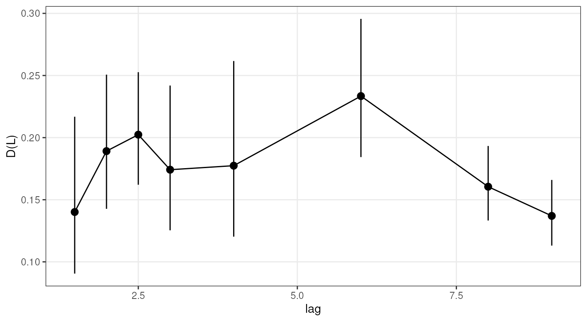

Dissimilarity does not grow steadily with the lag. Samples nine time
units apart are about as similar as samples 1.5 units apart. Each lag
pools different subjects, so in this cohort the profile also reflects
which subjects contribute to it.

The next three plots read a dissimilarity matrix stored by
[`addDissimilarity()`](https://microbiome.github.io/mia/reference/getDissimilarity.html)
from mia.

\
`tse`` ``<-`` `[`addDissimilarity`](https://microbiome.github.io/mia/reference/getDissimilarity.html)`(``tse``, method ``=`` ``"bray"``, assay.type ``=`` ``"counts"``)`\
`mg`` ``<-`` `[`addDissimilarity`](https://microbiome.github.io/mia/reference/getDissimilarity.html)`(``mg``, method ``=`` ``"bray"``, assay.type ``=`` ``"counts"``)`

**Does a community return to earlier states?**
[`plotRecurrence()`](https://0xmuluh.github.io/tempoPlot/reference/plotRecurrence.md)
draws the dissimilarity between every pair of samples of a subject.

\
[`plotRecurrence`](https://0xmuluh.github.io/tempoPlot/reference/plotRecurrence.md)`(``mg``, dissimilarity ``=`` ``"bray"``, time.col ``=`` ``"Time.hr"``,`\
`    group ``=`` ``"StudyIdentifier"``)`

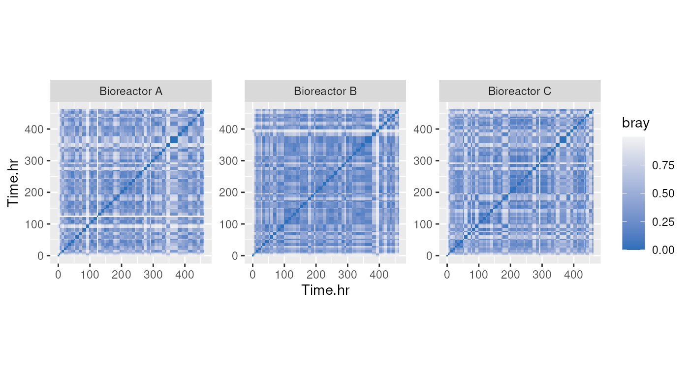

The first samples differ from all later ones, the bright edge at time
zero. A bright line marks a sample unlike all others. Dark areas away
from the diagonal mark returns to an earlier state.

**Are samples of the same person more alike than samples of different
people?**
[`plotIndividuality()`](https://0xmuluh.github.io/tempoPlot/reference/plotIndividuality.md)
compares the dissimilarities within subjects with those between
subjects.

\
[`plotIndividuality`](https://0xmuluh.github.io/tempoPlot/reference/plotIndividuality.md)`(``tse``, dissimilarity ``=`` ``"bray"``, group ``=`` ``"subject"``)`

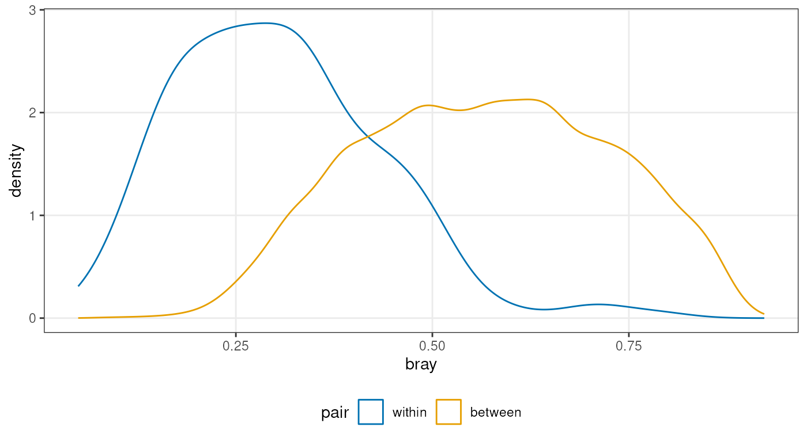

Samples of the same subject are more similar than samples of different
subjects. The within-subject curve peaks near 0.3, the between-subject
curve between 0.5 and 0.65.

**Can a person be recognised from an earlier sample?**
[`plotFingerprint()`](https://0xmuluh.github.io/tempoPlot/reference/plotFingerprint.md)
asks whether each subject’s second sample is closest to their own first
sample (Franzosa et al. 2015).

\
[`plotFingerprint`](https://0xmuluh.github.io/tempoPlot/reference/plotFingerprint.md)`(``tse``, dissimilarity ``=`` ``"bray"``, time.col ``=`` ``"visit"``,`\
`    group ``=`` ``"subject"``, time.point ``=`` `[`c`](https://rdrr.io/r/base/c.html)`(``"1"``, ``"2"``)``)`

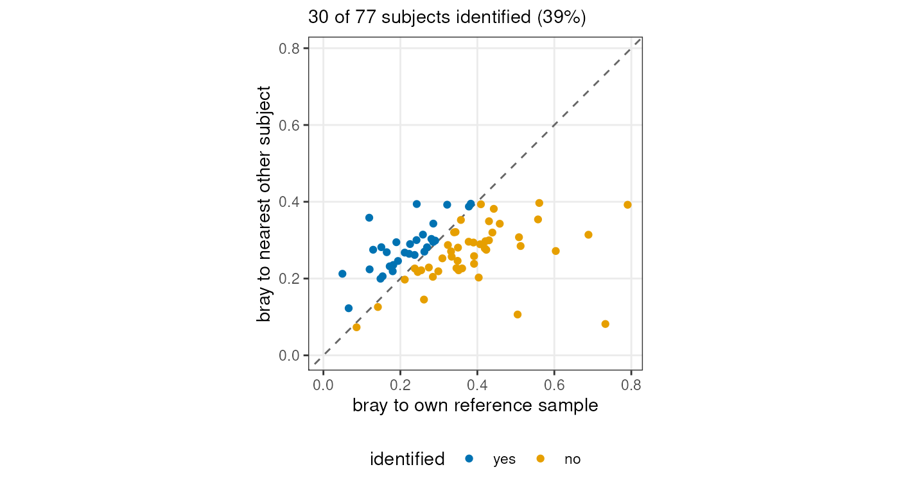

The title gives the share identified: 30 of 77 subjects (39%). Subjects
above the diagonal are closer to their own first sample than to anyone
else’s.

**Do communities of different people follow the same dynamics?**
[`plotDOC()`](https://0xmuluh.github.io/tempoPlot/reference/plotDOC.md)
draws the dissimilarity of each pair of samples against the overlap of
their features (Bashan et al. 2016).

\
`tse`` ``<-`` `[`transformAssay`](https://microbiome.github.io/mia/reference/transformAssay.html)`(``tse``, method ``=`` ``"relabundance"``)`\
`tse`` ``<-`` `[`addDissimilarity`](https://microbiome.github.io/mia/reference/getDissimilarity.html)`(``tse``, method ``=`` ``"overlap"``,`\
`    assay.type ``=`` ``"relabundance"``)`\
`tse`` ``<-`` `[`addDissimilarity`](https://microbiome.github.io/mia/reference/getDissimilarity.html)`(``tse``, method ``=`` ``"jsd"``, assay.type ``=`` ``"relabundance"``)`\
[`plotDOC`](https://0xmuluh.github.io/tempoPlot/reference/plotDOC.md)`(``tse``, overlap ``=`` ``"overlap"``, dissimilarity ``=`` ``"jsd"``,`\
`    group ``=`` ``"subject"``, pairs ``=`` ``"between"``)`

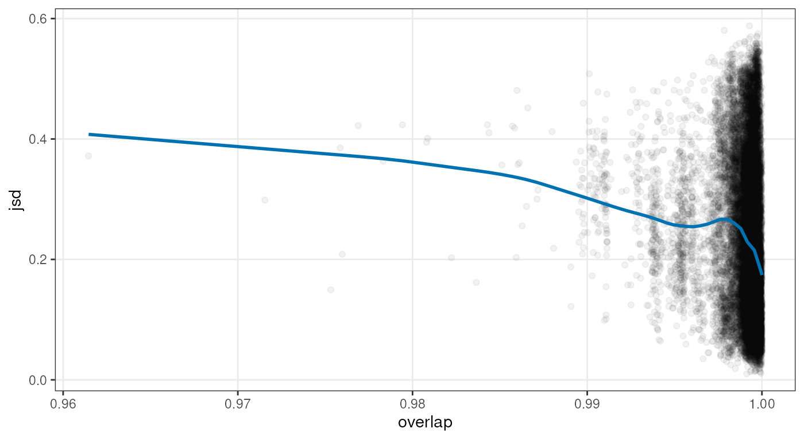

Overlap is close to one for every pair: the genera two people share
carry almost all of the abundance of both profiles. Within that narrow
range, dissimilarity falls as overlap approaches one. Bashan et al. read
this negative slope as dynamics shared across people.

## States and rhythms

**Does the dominant genus change between visits?**
[`addDominant()`](https://microbiome.github.io/mia/reference/getDominant.html)
from mia stores the dominant genus of each sample, keeping the four most
common and pooling the rest.
[`plotTransitionMatrix()`](https://0xmuluh.github.io/tempoPlot/reference/plotTransitionMatrix.md)
draws the share of moves from each state to the next.

\
`tse`` ``<-`` `[`addDominant`](https://microbiome.github.io/mia/reference/getDominant.html)`(``tse``, name ``=`` ``"dominant"``, n ``=`` ``4``)`\
[`plotTransitionMatrix`](https://0xmuluh.github.io/tempoPlot/reference/plotTransitionMatrix.md)`(``tse``, state.col ``=`` ``"dominant"``, time.col ``=`` ``"time"``,`\
`    group ``=`` ``"subject"``)`

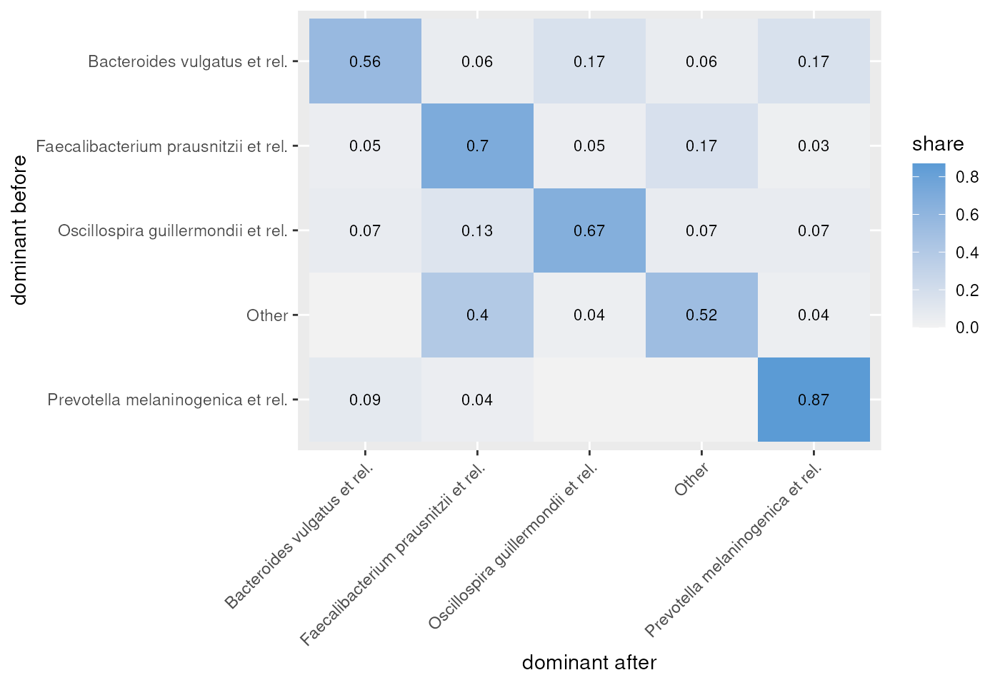

The diagonal dominates: most subjects keep their dominant genus from one
sample to the next. Prevotella is the most stable state (0.86), and
samples dominated by a genus outside the top four often move to
Faecalibacterium.

[`plotAlluvial()`](https://0xmuluh.github.io/tempoPlot/reference/plotAlluvial.md)
draws the same moves as flows over the first three visits. It needs the
ggalluvial package.

\
[`plotAlluvial`](https://0xmuluh.github.io/tempoPlot/reference/plotAlluvial.md)`(``tse``[``, ``tse``$``visit`` `[`%in%`](https://rdrr.io/r/base/match.html)` `[`c`](https://rdrr.io/r/base/c.html)`(``"1"``, ``"2"``, ``"3"``)``]``,`\
`    state.col ``=`` ``"dominant"``, time.col ``=`` ``"visit"``, group ``=`` ``"subject"``)`

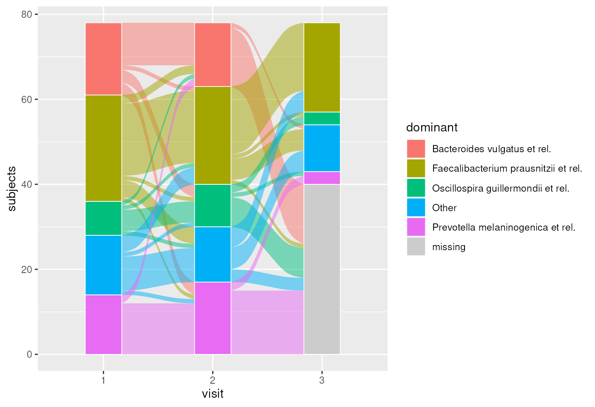

Most flows keep their colour. The grey block at visit 3 holds the
subjects sampled only twice.

**How long does a dominant genus last?**
[`plotSurvival()`](https://0xmuluh.github.io/tempoPlot/reference/plotSurvival.md)
draws the Kaplan-Meier curve of the time until the dominant genus first
differs from the one at the first sample.

\
[`plotSurvival`](https://0xmuluh.github.io/tempoPlot/reference/plotSurvival.md)`(``tse``, time.col ``=`` ``"time"``, group ``=`` ``"subject"``,`\
`    event ``=`` ``"state.exit"``, state.col ``=`` ``"dominant"``, group.by ``=`` ``"sex"``)`

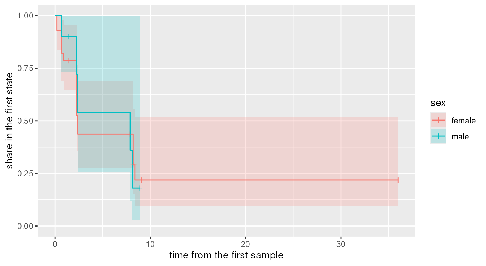

The share of subjects with their first dominant genus falls to about a
third within ten time units, and the curves of women and men overlap.
Crosses mark subjects whose last sample still had the first state.

**Does a genus have alternative states?**
[`plotLandscape()`](https://0xmuluh.github.io/tempoPlot/reference/plotLandscape.md)
draws the density of a variable, or its potential, the negative log of
the density. Bistability needs many people, so this step uses the first
sample of all 1006 subjects.

\
`first`` ``<-`` ``hitchip1006``[``, ``hitchip1006``$``time`` ``==`` ``0``]`\
`first`` ``<-`` `[`transformAssay`](https://microbiome.github.io/mia/reference/transformAssay.html)`(``first``, method ``=`` ``"relabundance"``)`\
`first`` ``<-`` `[`transformAssay`](https://microbiome.github.io/mia/reference/transformAssay.html)`(``first``, assay.type ``=`` ``"relabundance"``,`\
`    method ``=`` ``"log10"``, pseudocount ``=`` ``1e-4``, name ``=`` ``"log10"``)`\
[`plotLandscape`](https://0xmuluh.github.io/tempoPlot/reference/plotLandscape.md)`(``first``, y ``=`` ``"Prevotella melaninogenica et rel."``,`\
`    assay.type ``=`` ``"log10"``, scale ``=`` ``"potential"``)`

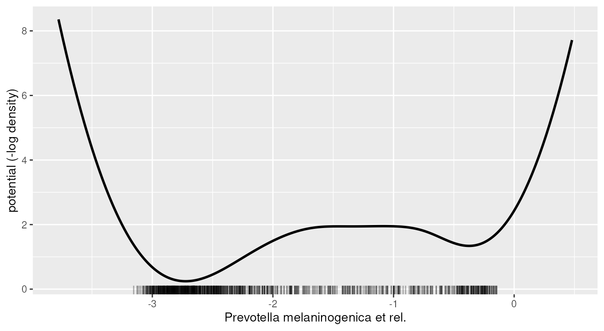

The potential has two wells: a deep one near 0.2% relative abundance
(log10 of -2.7) and a shallow one near 40% (-0.4). Most people sit in
the low state and a minority in the high one.

**Is there a daily rhythm?**
[`plotSpectrum()`](https://0xmuluh.github.io/tempoPlot/reference/plotSpectrum.md)
draws the periodogram of a series. The bioreactors were fasted once a
day.

\
[`plotSpectrum`](https://0xmuluh.github.io/tempoPlot/reference/plotSpectrum.md)`(``mg``, y ``=`` ``"Acetate"``, time.col ``=`` ``"Time.hr"``,`\
`    group ``=`` ``"StudyIdentifier"``)`

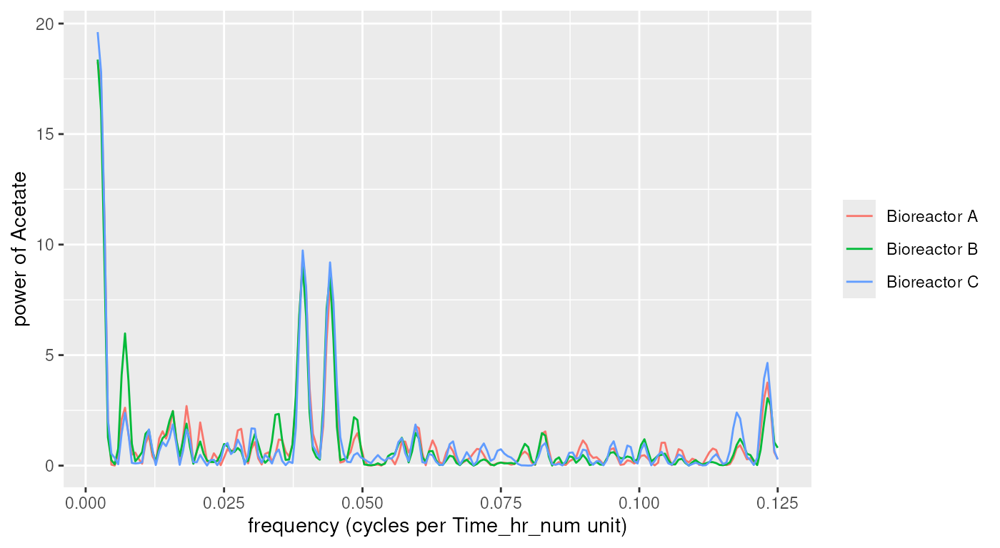

The peaks on either side of 0.042 cycles per hour, a period of 24 h,
match the daily fasting. The highest power, at the lowest frequencies,
is the slow rise and fall of acetate seen in the trend above.

**Which species change before or after acetate?**
[`plotLagHeatmap()`](https://0xmuluh.github.io/tempoPlot/reference/plotLagHeatmap.md)
correlates each feature with a target at lags of a few samples. Clr
values suit correlations better than proportions.

\
`mg`` ``<-`` `[`transformAssay`](https://microbiome.github.io/mia/reference/transformAssay.html)`(``mg``, assay.type ``=`` ``"counts"``, method ``=`` ``"clr"``,`\
`    pseudocount ``=`` ``1``)`\
[`plotLagHeatmap`](https://0xmuluh.github.io/tempoPlot/reference/plotLagHeatmap.md)`(``mg``, target ``=`` ``"Acetate"``, time.col ``=`` ``"Time.hr"``,`\
`    group ``=`` ``"StudyIdentifier"``, assay.type ``=`` ``"clr"``)`

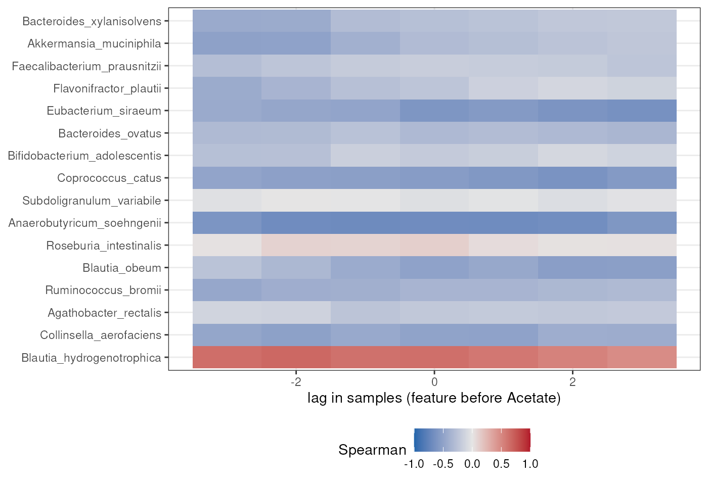

Blautia hydrogenotrophica rises with acetate and Anaerobutyricum
soehngenii falls with it. The correlations are about the same at every
lag, so neither series leads; both follow the change after 152 h.

## Features and subjects that stand out

**Which genera are bimodal?**
[`addBimodality()`](https://rdrr.io/pkg/miaTime/man/getBimodality.html)
from miaTime stores the coefficient of bimodality of each feature in
[`rowData()`](https://rdrr.io/pkg/SummarizedExperiment/man/SummarizedExperiment-class.html),
here of clr values, and
[`plotStats()`](https://0xmuluh.github.io/tempoPlot/reference/plotStats.md)
draws the highest.

\
`tse`` ``<-`` `[`transformAssay`](https://microbiome.github.io/mia/reference/transformAssay.html)`(``tse``, assay.type ``=`` ``"counts"``, method ``=`` ``"clr"``,`\
`    pseudocount ``=`` ``1``)`\
`tse`` ``<-`` `[`addBimodality`](https://rdrr.io/pkg/miaTime/man/getBimodality.html)`(``tse``, assay.type ``=`` ``"clr"``)`\
[`plotStats`](https://0xmuluh.github.io/tempoPlot/reference/plotStats.md)`(``tse``, stat ``=`` ``"bimodality"``, top ``=`` ``20``, colour.by ``=`` ``"Phylum"``)`

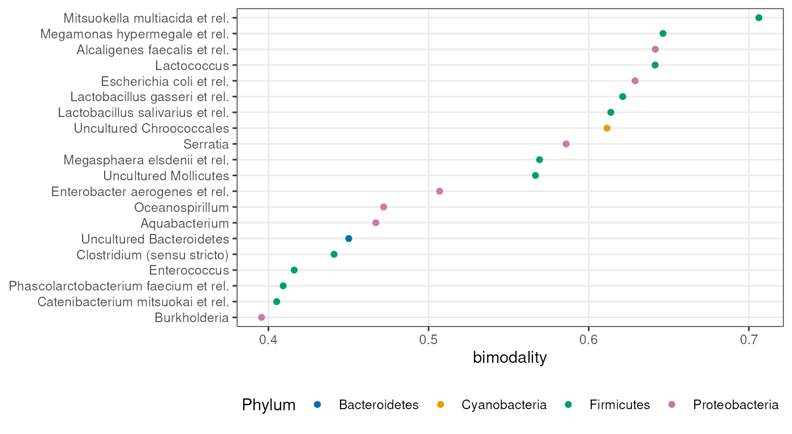

The coefficient runs from 0 to 1. High values mark genera that are
abundant in some samples and rare in others, led here by Mitsuokella
multiacida and Megamonas hypermegale.

**Which genera changed between the first and second visit?** Compute the
change and its p-value with any test, store them in
[`rowData()`](https://rdrr.io/pkg/SummarizedExperiment/man/SummarizedExperiment-class.html),
and draw them with
[`plotVolcano()`](https://0xmuluh.github.io/tempoPlot/reference/plotVolcano.md).
Here the mean paired difference in clr values, tested with a one-sample
t-test.

\
`pair`` ``<-`` ``tse``[``, ``tse``$``visit`` `[`%in%`](https://rdrr.io/r/base/match.html)` `[`c`](https://rdrr.io/r/base/c.html)`(``"1"``, ``"2"``)``]`\
`pair`` ``<-`` ``pair``[``, `[`order`](https://rdrr.io/r/base/order.html)`(``pair``$``visit``, ``pair``$``subject``)``]`\
`clr`` ``<-`` `[`assay`](https://rdrr.io/pkg/SummarizedExperiment/man/SummarizedExperiment-class.html)`(``pair``, ``"clr"``)`\
`d`` ``<-`` ``clr``[``, ``pair``$``visit`` ``==`` ``"2"``]`` ``-`` ``clr``[``, ``pair``$``visit`` ``==`` ``"1"``]`\
[`rowData`](https://rdrr.io/pkg/SummarizedExperiment/man/SummarizedExperiment-class.html)`(``tse``)``$``change`` ``<-`` `[`rowMeans`](https://rdrr.io/r/base/colSums.html)`(``d``)`\
[`rowData`](https://rdrr.io/pkg/SummarizedExperiment/man/SummarizedExperiment-class.html)`(``tse``)``$``p`` ``<-`` `[`apply`](https://rdrr.io/r/base/apply.html)`(``d``, ``1``, ``function``(``v``)`` `[`t.test`](https://rdrr.io/r/stats/t.test.html)`(``v``)``$``p.value``)`\
[`rowData`](https://rdrr.io/pkg/SummarizedExperiment/man/SummarizedExperiment-class.html)`(``tse``)``$``q`` ``<-`` `[`p.adjust`](https://rdrr.io/r/stats/p.adjust.html)`(`[`rowData`](https://rdrr.io/pkg/SummarizedExperiment/man/SummarizedExperiment-class.html)`(``tse``)``$``p``, method ``=`` ``"fdr"``)`\
[`plotVolcano`](https://0xmuluh.github.io/tempoPlot/reference/plotVolcano.md)`(``tse``, effect ``=`` ``"change"``, p.col ``=`` ``"q"``)`

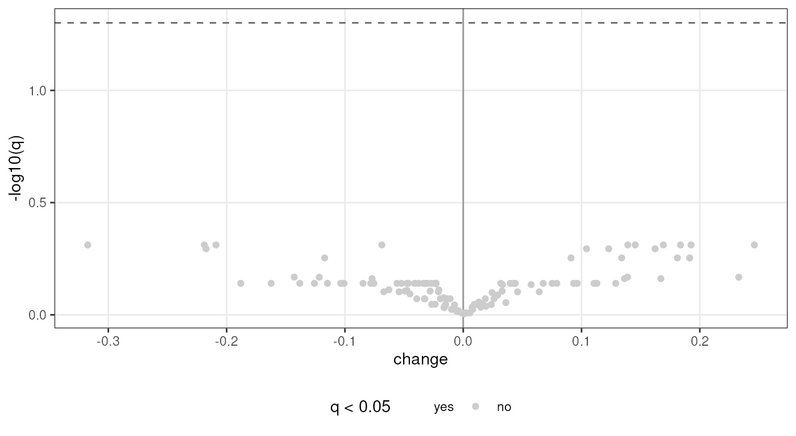

No genus passes q \< 0.05, the dashed line; points above it would be
coloured and labelled. The mean changes between the first two visits are
small relative to their variation between subjects.

**Do the species follow Taylor’s law over time?**
[`plotFeatureScatter()`](https://0xmuluh.github.io/tempoPlot/reference/plotFeatureScatter.md)
draws two statistics per feature. Computed over the samples of each
bioreactor, the mean and variance of the absolute abundances over time
give the temporal Taylor’s law.

\
[`plotFeatureScatter`](https://0xmuluh.github.io/tempoPlot/reference/plotFeatureScatter.md)`(``mg``, x.stat ``=`` ``"mean"``, y.stat ``=`` ``"variance"``,`\
`    fit ``=`` ``"power"``, group.by ``=`` ``"StudyIdentifier"``)`

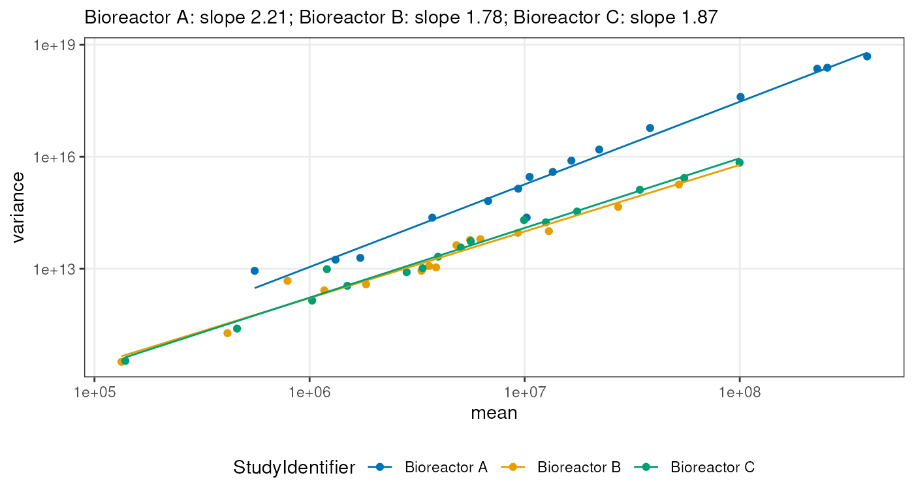

Variance grows as a power of the mean, with slopes of 1.8 to 2.2 in the
three bioreactors (given in the title). A slope near 2 means that each
species fluctuates by a similar proportion of its mean.

**Which subjects are diverse but unstable?**
[`plotSubjectScatter()`](https://0xmuluh.github.io/tempoPlot/reference/plotSubjectScatter.md)
draws two statistics per subject, here the mean and standard deviation
of diversity over each subject’s samples.

\
`tse``$``mean`` ``<-`` `[`ave`](https://rdrr.io/r/stats/ave.html)`(``tse``$``diversity``, ``tse``$``subject``, FUN ``=`` ``mean``)`\
`tse``$``sd`` ``<-`` `[`ave`](https://rdrr.io/r/stats/ave.html)`(``tse``$``diversity``, ``tse``$``subject``, FUN ``=`` ``sd``)`\
[`plotSubjectScatter`](https://0xmuluh.github.io/tempoPlot/reference/plotSubjectScatter.md)`(``tse``, x.stat ``=`` ``"mean"``, y.stat ``=`` ``"sd"``,`\
`    group ``=`` ``"subject"``, colour.by ``=`` ``"sex"``, quadrants ``=`` ``TRUE``)`

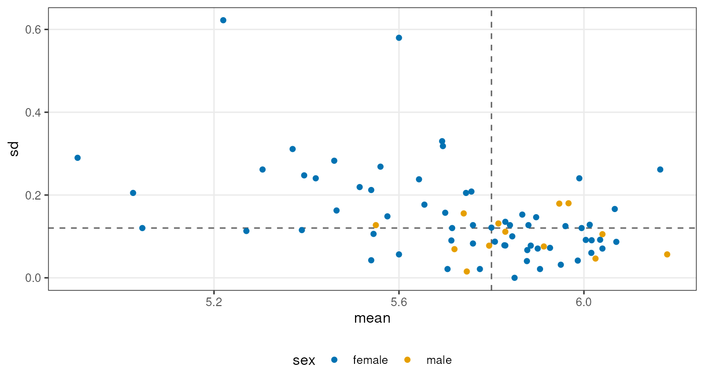

The dashed lines mark the medians. Subjects in the upper left have
below-median diversity that varies more than in most subjects.

**What are the main temporal patterns shared by the bioreactors?** A
tensor decomposition such as TEMPTED (Shi et al. 2024) splits the data
into subject, feature and time loadings. Store its result in
`metadata()`, and
[`plotTimeLoadings()`](https://0xmuluh.github.io/tempoPlot/reference/plotTimeLoadings.md)
draws the time loadings. This step needs the tempted package.

\
`metadata``(``mg``)``$``tempted`` ``<-`` ``tempted``::`[`tempted_all`](https://rdrr.io/pkg/tempted/man/tempted_all.html)`(`[`t`](https://rdrr.io/r/base/t.html)`(`[`assay`](https://rdrr.io/pkg/SummarizedExperiment/man/SummarizedExperiment-class.html)`(``mg``, ``"counts"``)``)``,`\
`    timepoint ``=`` ``mg``$``Time.hr``, subjectID ``=`` `[`as.character`](https://rdrr.io/r/base/character.html)`(``mg``$``StudyIdentifier``)``,`\
`    r ``=`` ``2``, threshold ``=`` ``1``, pseudo ``=`` ``0.5``, do_ratio ``=`` ``FALSE``)`\
[`plotTimeLoadings`](https://0xmuluh.github.io/tempoPlot/reference/plotTimeLoadings.md)`(``mg``, source ``=`` ``"tempted"``)`

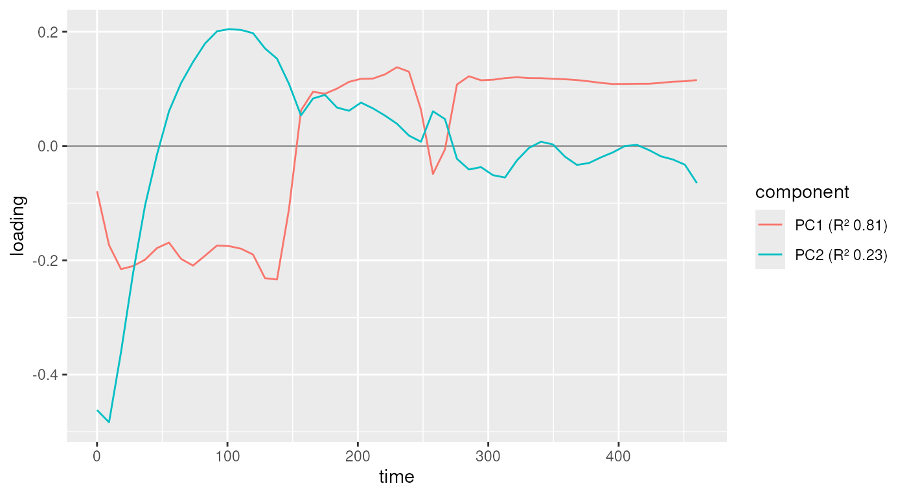

The first component changes sign when Blautia hydrogenotrophica is added
at 152 h and separates the communities before and after. The second
component captures the change during the first 100 h of the run. The
legend gives the variance each component explains.

## Ordinations and networks

**Do subjects move in a common direction?**
[`addMDS()`](https://microbiome.github.io/mia/reference/addMDS.html)
from mia stores a PCoA, and
[`plotPath()`](https://0xmuluh.github.io/tempoPlot/reference/plotPath.md)
connects each subject’s samples in it. `centroids = TRUE` adds the mean
path of each group.

\
`tse`` ``<-`` `[`addMDS`](https://microbiome.github.io/mia/reference/addMDS.html)`(``tse``, assay.type ``=`` ``"relabundance"``, method ``=`` ``"bray"``,`\
`    name ``=`` ``"PCoA"``)`\
[`plotPath`](https://0xmuluh.github.io/tempoPlot/reference/plotPath.md)`(``tse``, time.col ``=`` ``"visit"``, group ``=`` ``"subject"``, dimred ``=`` ``"PCoA"``,`\
`    group.by ``=`` ``"sex"``, centroids ``=`` ``TRUE``)`

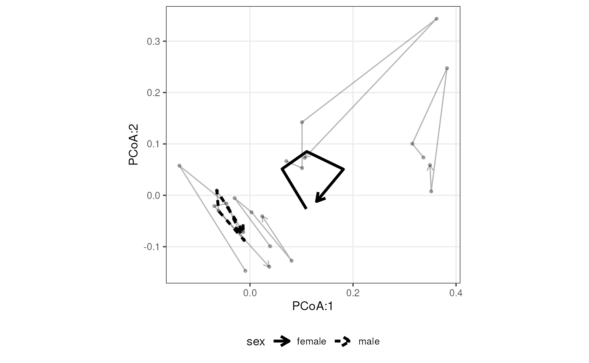

Each grey arrow is one step of one subject. Most steps are short next to
the distances between subjects. The mean paths of women and men stay
near the centre, so the cohort has no common direction of change.

With many samples per subject,
[`plotDirection()`](https://0xmuluh.github.io/tempoPlot/reference/plotDirection.md)
summarises the directions of the steps between consecutive samples.

\
`mg`` ``<-`` `[`addMDS`](https://microbiome.github.io/mia/reference/addMDS.html)`(``mg``, assay.type ``=`` ``"relabundance"``, method ``=`` ``"bray"``,`\
`    name ``=`` ``"PCoA"``)`\
[`plotDirection`](https://0xmuluh.github.io/tempoPlot/reference/plotDirection.md)`(``mg``, time.col ``=`` ``"Time.hr"``, group ``=`` ``"StudyIdentifier"``,`\
`    dimred ``=`` ``"PCoA"``, facet.by ``=`` ``"StudyIdentifier"``)`

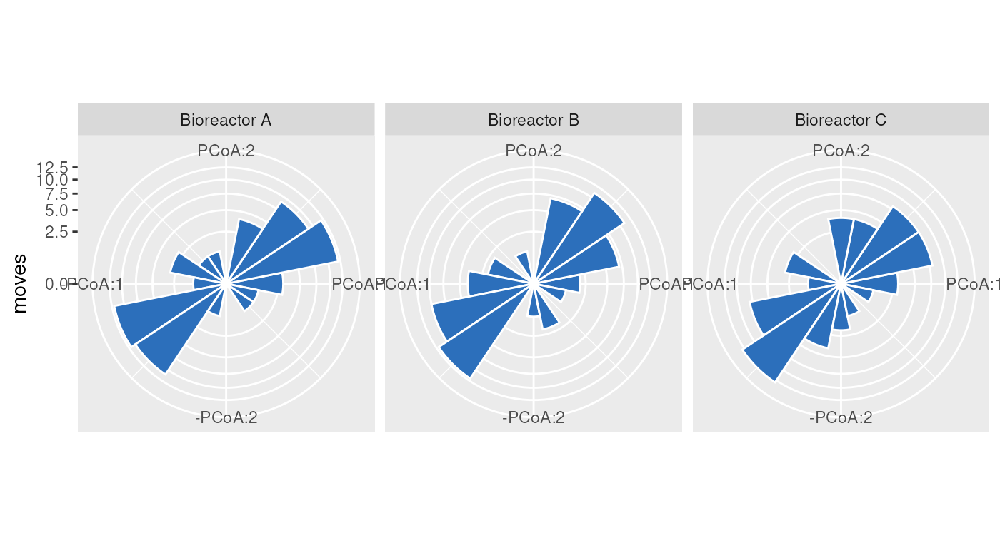

In all three bioreactors most steps point to the upper right or the
lower left: the communities move back and forth along one direction.

**Do two ordinations tell the same story?**
[`plotProcrustes()`](https://0xmuluh.github.io/tempoPlot/reference/plotProcrustes.md)
rotates one ordination onto another and joins the two positions of each
sample. Here the Bray-Curtis PCoA against the Aitchison PCoA, the
Euclidean distance of clr values.

\
`mg`` ``<-`` `[`addMDS`](https://microbiome.github.io/mia/reference/addMDS.html)`(``mg``, assay.type ``=`` ``"clr"``, method ``=`` ``"euclidean"``,`\
`    name ``=`` ``"Aitchison"``)`\
[`plotProcrustes`](https://0xmuluh.github.io/tempoPlot/reference/plotProcrustes.md)`(``mg``, dimred ``=`` ``"PCoA"``, dimred2 ``=`` ``"Aitchison"``,`\
`    colour.by ``=`` ``"StudyIdentifier"``)`

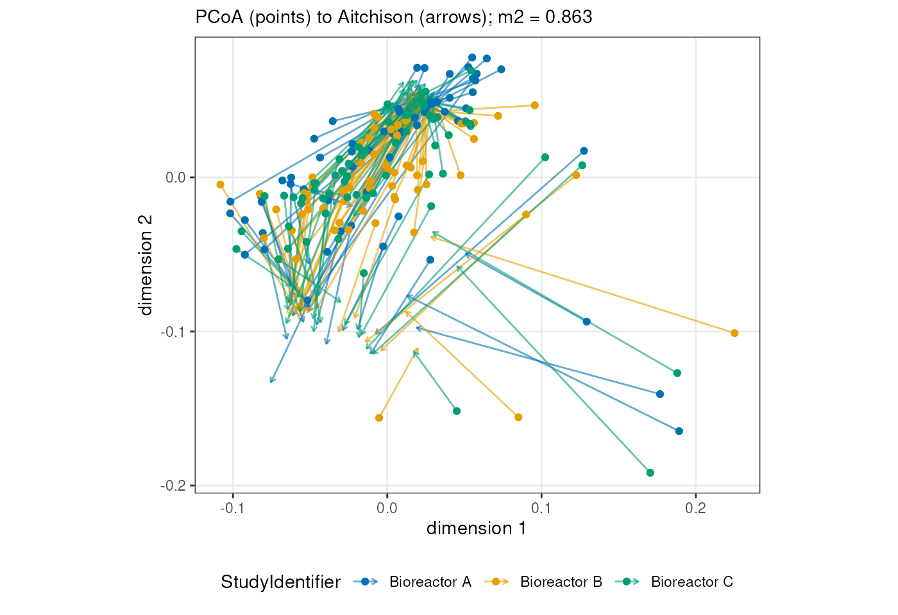

The statistic m2 in the title runs from 0 for identical configurations
to 1. Here it is 0.86: the two distances arrange these samples
differently, so a pattern seen in one ordination should be checked in
the other.

**Do species associations change after a perturbation?** Compute an edge
table, store it in `metadata()`, and draw it with
[`plotNetwork()`](https://0xmuluh.github.io/tempoPlot/reference/plotNetwork.md).
Here clr correlations above 0.6 before and after Blautia
hydrogenotrophica was added at 152 h; `diff = TRUE` marks the edges
gained and lost.

\
`window`` ``<-`` `[`ifelse`](https://rdrr.io/r/base/ifelse.html)`(``mg``$``Time.hr`` ``<`` ``152``, ``"before"``, ``"after"``)`\
`edges`` ``<-`` `[`do.call`](https://rdrr.io/r/base/do.call.html)`(``rbind``, `[`lapply`](https://rdrr.io/r/base/lapply.html)`(`[`c`](https://rdrr.io/r/base/c.html)`(``"before"``, ``"after"``)``, ``function``(``w``)`` ``{`\
`    ``r`` ``<-`` `[`cor`](https://rdrr.io/r/stats/cor.html)`(`[`t`](https://rdrr.io/r/base/t.html)`(`[`assay`](https://rdrr.io/pkg/SummarizedExperiment/man/SummarizedExperiment-class.html)`(``mg``, ``"clr"``)``[``, ``window`` ``==`` ``w``]``)``)`\
`    ``i`` ``<-`` `[`which`](https://rdrr.io/r/base/which.html)`(`[`abs`](https://rdrr.io/r/base/MathFun.html)`(``r``)`` ``>`` ``0.6`` ``&`` `[`upper.tri`](https://rdrr.io/r/base/lower.tri.html)`(``r``)``, arr.ind ``=`` ``TRUE``)`\
`    `[`data.frame`](https://rdrr.io/r/base/data.frame.html)`(``from ``=`` `[`rownames`](https://rdrr.io/r/base/colnames.html)`(``r``)``[``i``[``, ``1``]``]``, to ``=`` `[`rownames`](https://rdrr.io/r/base/colnames.html)`(``r``)``[``i``[``, ``2``]``]``,`\
`        weight ``=`` ``r``[``i``]``, window ``=`` ``w``)`\
`}``)``)`\
`metadata``(``mg``)``$``correlations`` ``<-`` ``edges`\
[`plotNetwork`](https://0xmuluh.github.io/tempoPlot/reference/plotNetwork.md)`(``mg``, edges ``=`` ``"correlations"``, split.by ``=`` ``"window"``, diff ``=`` ``TRUE``)`

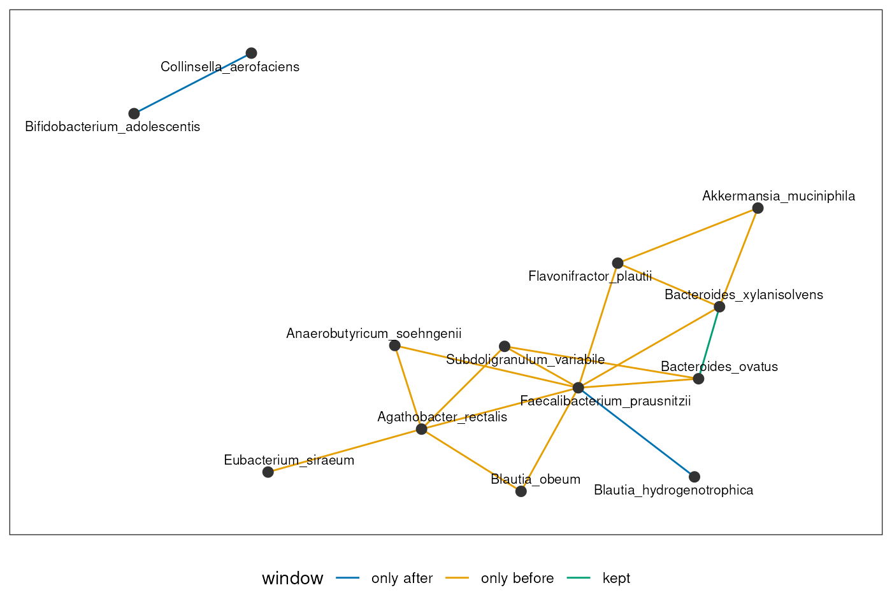

Most strong correlations of the first 152 h are absent afterwards. After
the addition, Blautia hydrogenotrophica correlates with Faecalibacterium
prausnitzii, and only the edge between the two Bacteroides species is
kept.

## One subject at a time

[`plotTimeline()`](https://0xmuluh.github.io/tempoPlot/reference/plotTimeline.md)
stacks one subject’s composition, numeric variables, a state strip and
events over a shared time axis. Here the state is the dominant species
of each sample.

\
`mg`` ``<-`` `[`addDominant`](https://microbiome.github.io/mia/reference/getDominant.html)`(``mg``, name ``=`` ``"dominant"``)`\
[`plotTimeline`](https://0xmuluh.github.io/tempoPlot/reference/plotTimeline.md)`(``mg``, time.col ``=`` ``"Time.hr"``, group ``=`` ``"StudyIdentifier"``,`\
`    subject ``=`` ``"Bioreactor A"``, y ``=`` `[`c`](https://rdrr.io/r/base/c.html)`(``"Acetate"``, ``"Butyrate"``)``,`\
`    state.col ``=`` ``"dominant"``, events ``=`` ``events``, top ``=`` ``8``, layout ``=`` ``"area"``)`

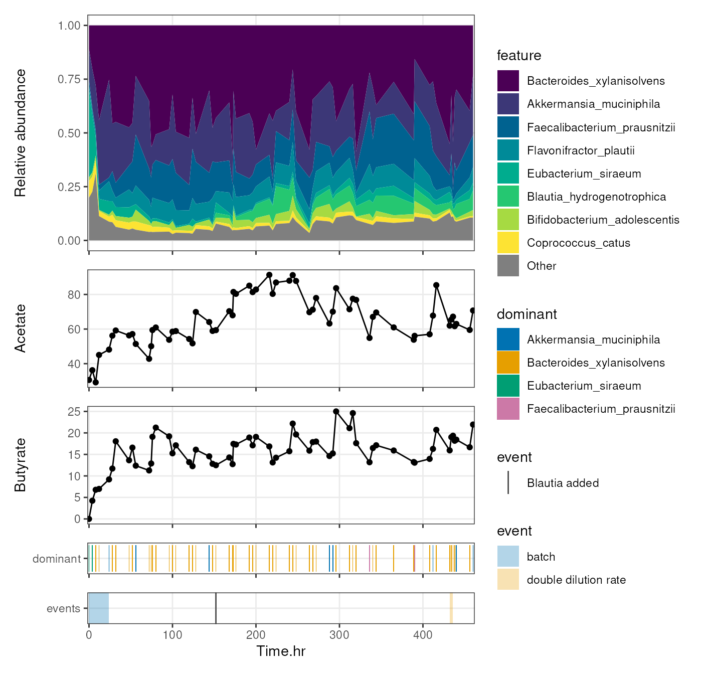

The other functions return `ggplot` objects, so the
*[patchwork](https://CRAN.R-project.org/package=patchwork)* package
combines any of them over a shared time axis.

\
[`library`](https://rdrr.io/r/base/library.html)`(`[`patchwork`](https://patchwork.data-imaginist.com)`)`\
`a`` ``<-`` ``mg``[``, ``mg``$``StudyIdentifier`` ``==`` ``"Bioreactor A"``]`\
[`plotTrend`](https://0xmuluh.github.io/tempoPlot/reference/plotTrend.md)`(``a``, y ``=`` ``"Acetate"``, time.col ``=`` ``"Time.hr"``)`` ``/`\
`    `[`plotComposition`](https://0xmuluh.github.io/tempoPlot/reference/plotComposition.md)`(``a``, time.col ``=`` ``"Time.hr"``, top ``=`` ``8``, layout ``=`` ``"area"``)`` ``/`\
`    `[`plotTurnover`](https://0xmuluh.github.io/tempoPlot/reference/plotTurnover.md)`(``a``, time.col ``=`` ``"Time.hr"``)`` ``+`\
`    `[`plot_layout`](https://patchwork.data-imaginist.com/reference/plot_layout.html)`(``axes ``=`` ``"collect"``)`

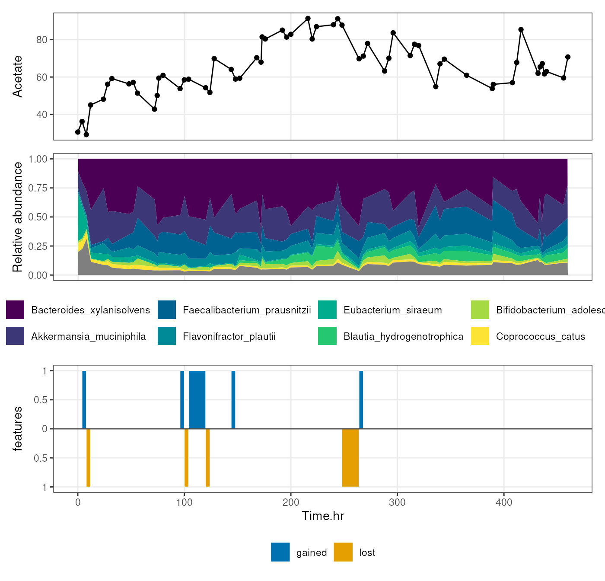

## References

Bashan A, et al. (2016). Universality of human microbial dynamics.
*Nature* 534(7606):259-262.

Franzosa EA, et al. (2015). Identifying personal microbiomes using
metagenomic codes. *PNAS* 112(22):E2930-E2938.

Lahti L, et al. (2014). Tipping elements in the human intestinal
ecosystem. *Nature Communications* 5:4344.

Legendre P (2019). A temporal beta-diversity index to identify sites
that have changed in exceptional ways in space-time surveys. *Ecology
and Evolution* 9(6):3500-3514.

Shetty SA, et al. (2022). Dynamic metabolic interactions and trophic
roles of human gut microbes identified using a minimal microbiome
exhibiting ecological properties. *The ISME Journal* 16:2144-2159.

Shi P, et al. (2024). TEMPTED: time-informed dimensionality reduction
for longitudinal microbiome studies. *Genome Biology* 25:317.

## Session info

Session info

\
[`sessionInfo`](https://rdrr.io/r/utils/sessionInfo.html)`(``)`\
`#> R version 4.6.1 (2026-06-24)`\
`#> Platform: x86_64-pc-linux-gnu`\
`#> Running under: Ubuntu 24.04.5 LTS`\
`#> `\
`#> Matrix products: default`\
`#> BLAS:   /usr/lib/x86_64-linux-gnu/openblas-pthread/libblas.so.3 `\
`#> LAPACK: /usr/lib/x86_64-linux-gnu/openblas-pthread/libopenblasp-r0.3.26.so;  LAPACK version 3.12.0`\
`#> `\
`#> locale:`\
`#>  [1] LC_CTYPE=en_US.UTF-8       LC_NUMERIC=C              `\
`#>  [3] LC_TIME=en_US.UTF-8        LC_COLLATE=en_US.UTF-8    `\
`#>  [5] LC_MONETARY=en_US.UTF-8    LC_MESSAGES=en_US.UTF-8   `\
`#>  [7] LC_PAPER=en_US.UTF-8       LC_NAME=C                 `\
`#>  [9] LC_ADDRESS=C               LC_TELEPHONE=C            `\
`#> [11] LC_MEASUREMENT=en_US.UTF-8 LC_IDENTIFICATION=C       `\
`#> `\
`#> time zone: UTC`\
`#> tzcode source: system (glibc)`\
`#> `\
`#> attached base packages:`\
`#> [1] stats4    stats     graphics  grDevices utils     datasets  methods  `\
`#> [8] base     `\
`#> `\
`#> other attached packages:`\
`#>  [1] patchwork_1.3.2                 miaTime_1.3.7                  `\
`#>  [3] mia_1.21.34                     TreeSummarizedExperiment_2.21.0`\
`#>  [5] Biostrings_2.81.9               XVector_0.53.0                 `\
`#>  [7] SingleCellExperiment_1.35.2     MultiAssayExperiment_1.39.1    `\
`#>  [9] SummarizedExperiment_1.43.0     Biobase_2.73.2                 `\
`#> [11] GenomicRanges_1.65.4            Seqinfo_1.3.2                  `\
`#> [13] IRanges_2.47.5                  S4Vectors_0.51.10              `\
`#> [15] BiocGenerics_0.59.13            generics_0.1.4                 `\
`#> [17] MatrixGenerics_1.25.0           matrixStats_1.5.0              `\
`#> [19] tempoPlot_0.99.69               knitr_1.52                     `\
`#> [21] BiocStyle_2.41.0               `\
`#> `\
`#> loaded via a namespace (and not attached):`\
`#>   [1] RColorBrewer_1.1-3          shape_1.4.6.1              `\
`#>   [3] jsonlite_2.0.0              magrittr_2.0.5             `\
`#>   [5] ggbeeswarm_0.7.3            farver_2.1.2               `\
`#>   [7] rmarkdown_2.32              fs_2.1.0                   `\
`#>   [9] ragg_1.5.2                  vctrs_0.7.3                `\
`#>  [11] DelayedMatrixStats_1.35.0   htmltools_0.5.9            `\
`#>  [13] S4Arrays_1.13.3             BiocNeighbors_2.7.3        `\
`#>  [15] SparseArray_1.13.5          sass_0.4.10                `\
`#>  [17] bslib_0.12.0                htmlwidgets_1.6.4          `\
`#>  [19] desc_1.4.3                  plyr_1.8.9                 `\
`#>  [21] DECIPHER_3.9.6              cachem_1.1.0               `\
`#>  [23] igraph_2.3.4                iterators_1.0.14           `\
`#>  [25] lifecycle_1.0.5             pkgconfig_2.0.3            `\
`#>  [27] rsvd_1.0.6                  Matrix_1.7-6               `\
`#>  [29] R6_2.6.1                    fastmap_1.2.0              `\
`#>  [31] rbibutils_2.4.1             digest_0.6.39              `\
`#>  [33] tempted_0.1.2               scater_1.41.3              `\
`#>  [35] irlba_2.4.1                 textshaping_1.0.5          `\
`#>  [37] vegan_2.7-6                 beachmat_2.29.3            `\
`#>  [39] labeling_0.4.3              abind_1.4-8                `\
`#>  [41] mgcv_1.9-4                  compiler_4.6.1             `\
`#>  [43] withr_3.0.3                 S7_0.2.2                   `\
`#>  [45] BiocParallel_1.47.0         viridis_0.6.5              `\
`#>  [47] DBI_1.3.0                   MASS_7.3-66                `\
`#>  [49] quantreg_6.1                rappdirs_0.3.4             `\
`#>  [51] DelayedArray_0.39.8         bluster_1.23.1             `\
`#>  [53] permute_0.9-10              tools_4.6.1                `\
`#>  [55] vipor_0.4.7                 otel_0.2.0                 `\
`#>  [57] beeswarm_0.4.0              ape_5.8-1                  `\
`#>  [59] glue_1.8.1                  quadprog_1.5-8             `\
`#>  [61] nlme_3.1-171                grid_4.6.1                 `\
`#>  [63] cluster_2.1.8.3             reshape2_1.4.5             `\
`#>  [65] gtable_0.3.6                tidyr_1.3.2                `\
`#>  [67] BiocSingular_1.29.3         ScaledMatrix_1.21.0        `\
`#>  [69] foreach_1.5.2               ggrepel_0.9.8              `\
`#>  [71] pillar_1.11.1               stringr_1.6.0              `\
`#>  [73] yulab.utils_0.2.5           splines_4.6.1              `\
`#>  [75] dplyr_1.2.1                 treeio_1.37.1              `\
`#>  [77] lattice_0.23-1              survival_3.8-12            `\
`#>  [79] SparseM_1.84-2              tidyselect_1.2.1           `\
`#>  [81] DirichletMultinomial_1.55.1 scuttle_1.23.2             `\
`#>  [83] gridExtra_2.3.1             bookdown_0.48              `\
`#>  [85] xfun_0.62                   stringi_1.8.9              `\
`#>  [87] lazyeval_0.2.3              yaml_2.3.12                `\
`#>  [89] boot_1.3-32                 evaluate_1.0.5             `\
`#>  [91] codetools_0.2-20            tibble_3.3.1               `\
`#>  [93] BiocManager_1.30.27         cli_3.6.6                  `\
`#>  [95] systemfonts_1.3.2           Rdpack_2.6.6               `\
`#>  [97] jquerylib_0.1.4             Rcpp_1.1.2                 `\
`#>  [99] parallel_4.6.1              MatrixModels_0.5-4         `\
`#> [101] pkgdown_2.2.1               ggplot2_4.0.3              `\
`#> [103] ggalluvial_0.12.6           sparseMatrixStats_1.25.0   `\
`#> [105] glmnet_5.1                  decontam_1.33.0            `\
`#> [107] viridisLite_0.4.3           tidytree_0.4.8             `\
`#> [109] scales_1.4.0                np_0.80-1                  `\
`#> [111] purrr_1.2.2                 crayon_1.5.3               `\
`#> [113] rlang_1.3.0`
